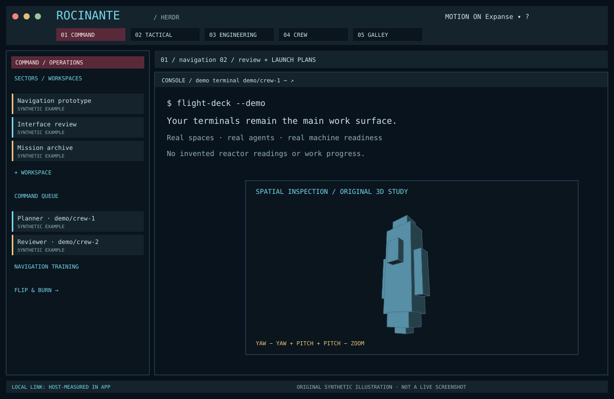
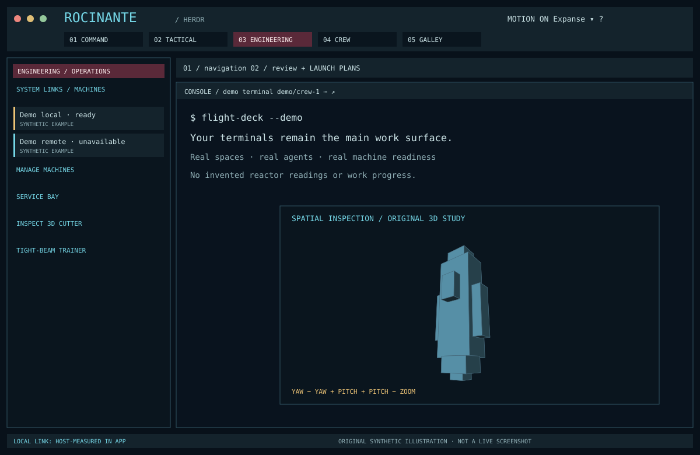
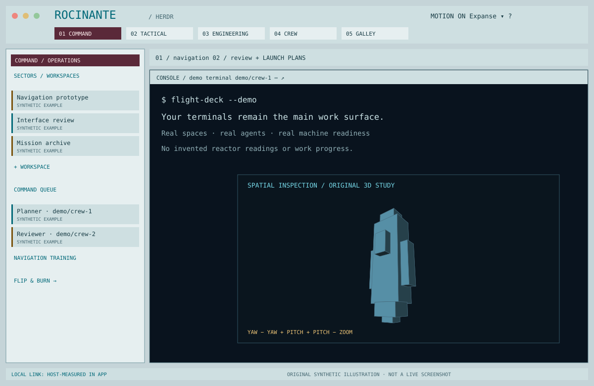

# Expanse Flight Deck for Herdr

**Your workspaces, aboard an independent ship.**

A native Herdr layout inspired by the Rocinante’s practical shipboard interfaces: layered cyan outlines, burgundy command strips, amber decisions, readable terminals, and a crew manifest that tells the truth. Move between five operational rooms, inspect an original 3D service cutter, or go off watch with two complete training games.



*Original synthetic illustration, not a live screenshot. Example names and terminal text are invented. The app uses your actual Herdr data.*

[Install](#come-aboard) · [Deck tour](#five-stations-one-workspace) · [Games](#off-watch-training) · [3D inspection](#walk-around-the-ship) · [Discoveries](#a-few-things-worth-finding) · [Research](docs/RESEARCH.md)

## What makes this a flight deck

- **Five useful rooms:** Command, Tactical, Engineering, Crew and Galley. Each changes the side console while your terminals stay central.
- **Real operations:** spaces, tabs, agents and connected machines retain their names, addresses and current states.
- **Two original games:** three inertial rendezvous courses and 999 deterministic relay puzzles, with rules, reset, hints, win/loss feedback and local bests.
- **Interactive projected 3D:** a 48-face original cutter with yaw, pitch, lighting, perspective and component inspection.
- **Native throughout:** GPUI panels, menus, pane chrome, dialogs and an integrated layout switcher. No browser UI.
- **Quiet by default:** original acknowledgment audio is muted, motion is restrained and can be disabled visibly.
- **Deliberate light and dark chrome:** both retain dark terminal surfaces for readable existing agent output.

An unofficial fan interface. No ripped screen graphics, show logos, actor likenesses, music, commercial fonts or licensed ship models are bundled.

## Come aboard

Requires a compatible installed **Herdr desktop app**, its `herdr-app` CLI, [daft](https://github.com/avihut/daft), [mise](https://mise.jdx.dev/) and pnpm. Local network/battery probes currently support macOS.

```sh
daft clone https://github.com/avihut/herdr-expanse.git --layout contained
cd herdr-expanse/main
mise trust
mise install
mise run test
mise run check
mise run install
```

`mise run install` is intentionally explicit because `mise install` installs development tools. The layout installer performs native validation before exposing its complete staged mod. It refuses existing Expanse targets, then installs the mod, themes, preview and layout in that order. It leaves your active layout, appearance, settings and keyboard bindings alone.

Select **Expanse** from your existing layout menu or Herdr’s layout settings. Once aboard, **Expanse ▾** in the top bar is its own native, keyboard-navigable layout picker. It uses the personal-copy replacement rules, shows the current layout and sizes the pointer popup to its contents.

### Updating and recovery

Update the source worktree using your normal daft workflow, review the change, then:

```sh
mise run test
mise run check
mise run update
```

Updates preserve unowned files inside the Expanse mod, retain previous package targets under `~/.config/herdr-app/backups/expanse/`, and swap complete staged folders with renames. They never copy a live JavaScript module one file at a time. The layout JSON is exposed last.

Symlink paths and escaping/missing local imports are refused. A failure restores replaced targets. If restoration itself fails, the installer stops and prints the retained staging and backup locations for recovery. It does not erase those recovery files or restart anything.

For an isolated configuration:

```sh
pnpm run install:layout --config-dir /path/to/test-config
```

Coordinate installation and live QA when several agents share a window. See the portable [layout guide](docs/LAYOUT_GUIDE.md); a free QA slot does not grant filesystem or socket permission.

## Five stations, one workspace

| Station | What it does | Try this |
| --- | --- | --- |
| **01 Command** | Lists every workspace and the pending attention queue | Select a sector; right-click it to rename or create a tab |
| **02 Tactical** | Groups all agents by `blocked`, `done`, `working`, `idle` | Open the actual agent that needs input |
| **03 Engineering** | Shows real Herdr machine layout readiness, associated spaces and settings | Inspect the cutter or open the relay trainer |
| **04 Crew** | Full agent manifest, with actual names and addresses | Pin or peek a particular station from its context menu |
| **05 Galley** | Games, lore cards, discoveries, palettes and comfort settings | Brew a quiet cup or inspect the sealed sample |

The resizable side console scrolls its complete lists. **SECTORS** folds it away. Narrow top bars shorten station labels to CMD / TAC / ENG; **M+ / M−** is the compact motion control.

**Flight plans** are tabs. The tab strip scrolls horizontally; **PLANS** opens the complete scrollable list across workspaces. **+ LAUNCH** starts a terminal or an installed agent detected for the selected workspace’s machine. Existing Herdr keyboard shortcuts continue to work.

Every console header carries its title, terminal address, target menu and zoom control. Right-click a workspace, tab, crew station or pane to act on that exact object—even when another terminal has focus. If the optional shared `pane-rename` mod advertises API version 1, the pane menu offers **Rename pane…** and headers honor its names. Without it, native titles and the other actions remain available. This package neither installs nor updates that optional dependency.

### The metaphor, with real names intact

| Herdr | Flight deck | Meaning preserved |
| --- | --- | --- |
| Workspace | Operational sector | Name, host machine and active selection |
| Tab | Flight plan | Name, index, split panes and active state |
| Pane | Console | Actual keyboard target, split, zoom, copy/paste and close |
| Agent | Crew/program station | Reported title, address, pin and focus |
| Working | Cyan activity strip | Agent reports active work |
| Blocked | Amber attention | Agent needs your input |
| Done | Green completion | Finished while unseen; becomes idle when viewed |
| Idle | Muted standby | Agent reports idle |
| Machine | System link | Real Herdr `ready`, `loading` or `unavailable` state |

No ordinary agent is portrayed as an enemy. There are no fabricated progress percentages, threat levels, reactor temperatures, oxygen readings or ship health gauges.

## Off-watch training

Both games open from Galley, the relevant operational station, or **?**. They run locally, take no real-world actions and have a safe **CLOSE ×** exit. Herdr’s Escape closes their dialog.

### Flip & Burn — think in momentum

A turn-based inertial rendezvous puzzle on a 9×7 board. Guide **◆** to **◎**, arriving with **zero velocity**. **×** marks debris.

1. A cardinal burn changes one velocity component by one and costs one fuel unit.
2. Position then advances by the new velocity. Coasting advances position without changing velocity or using fuel.
3. Speed is capped at ±2 cells per tick on each axis. Over-speed and unaffordable burns are rejected without spending time.
4. Avoid the board boundary and debris. Collision testing checks the entire traveled segment, including hazards between cells.
5. Dock before the tick limit. Running out of fuel while stopped away from the target, collision or timeout ends the run.

| Course | Burn budget | Tick limit |
| --- | ---: | ---: |
| Clearance corridor | 10 | 18 |
| Debris passage | 12 | 20 |
| Return vector | 12 | 22 |

**Controls:** arrow keys / WASD or on-screen burn buttons; Space to coast; U or **UNDO** to restore the previous maneuver and its resources. **FLIGHT HINT** searches for a reachable route from the current state, or recommends undo/restart when no route remains. Restart resets the selected course.

Local bests use `ticks + 3 × burns used + 5 × hints`; lower is better. Hint penalties survive undo. A complete win awards the **Flight qualified** patch.

The motif comes from the series’ flip-and-burn maneuver. The rules are an original discrete game abstraction: there is no gravity model, real orbital mechanics, measured thrust or spacecraft control.

### Tight-Beam Relay — authenticate the whole route

An original signal-routing puzzle. Rotate a 4×4 field of relays so the left-hand **TX** port at cell 01 connects to the left-hand **RX** port at cell 13, visiting **all 16 relays exactly once**.

- Click a tile to rotate it clockwise by 90°. Each click spends one rotation.
- Ports must meet in neighboring cells. An open edge, mismatched receiver, loop or incomplete authentication chain fails transmission.
- The live trace shows where the signal currently reaches. You still choose when to transmit.
- You have **three transmit attempts**. A failed attempt is spent permanently; the third failure ends the run.
- The rotation budget is the seeded board’s canonical repair cost plus six. At zero remaining rotations, transmit, undo or restart.
- **UNDO** refunds a rotation, never a transmission. **ALIGNMENT HINT** marks a tile that needs adjustment. **RESTART SEED** restores the same puzzle; **NEXT SEED** advances through 1–999.

**Keyboard:** arrows select a tile, Enter / Space rotates it, T transmits. Local bests use `rotations + 5 × failed transmits + 5 × hints`; lower is better. Success awards **Tight beam**.

All 999 seeds are tested for a complete winning route within their exact budgets. The relay chain and authentication rules are invented gameplay, not a simulation of the show’s communications protocol. No packets are sent.

## Walk around the ship



**Engineering → Inspect 3D Cutter** opens an original compact vertical-deck service-cutter study. Turn it with **YAW ±** and **PITCH ±**, switch zoom and select a component to highlight its faces and read a short inspection note. Reset restores the original view.

This is real interactive **projected 3D**: 48 faces have XYZ vertices, yaw/pitch transformations, perspective division, face-normal lighting and depth sorting. Native GPUI paths draw the result. It is not a native 3D engine, a rotating flat image or a screen-accurate licensed Rocinante model. Orientation changes only on user input; there is no continuous JavaScript redraw loop.

## Light, motion and sound



| Control | Behavior |
| --- | --- |
| Appearance | Follows Herdr’s light/dark preference with separate chrome palettes |
| Terminal surface | Dark in both appearances, with a readable dark ANSI palette |
| ROCI | Restrained cyan accent, burgundy strips and amber decisions |
| UNN | A blue accent study inspired by the production’s faction language |
| BELT | An amber accent study inspired by its warm Belter palette |
| MOTION / M± | Disables native working-status and specimen opacity pulses |
| ACK SOUND | Muted by default; enables a short original synthesized award tone |

Faction options are small palette adaptations, not claims to reproduce every faction’s operating system. There is no show soundtrack or speech. Game controls and model rotation remain responsive with reduced motion enabled.

## Honest host status

The footer distinguishes **this computer’s local interface** from Herdr’s remote machine state.

| Indicator | Measurement |
| --- | --- |
| LINK UP | `scutil --nwi` reports active local interfaces; **not proof of Internet access** |
| LINK DOWN | A recognized response reports no active interfaces |
| LINK ? | Probe failed, returned an unrecognized response or platform is unsupported |
| Battery icon + percent | Only when internal battery hardware is detected |
| CHARGING / AC / BAT | Real parsed power-source and charge state |
| BAT ? | Previously detected battery hardware is now unreadable; stale percent is discarded |

Read-only local probes run at most every 30 seconds from one footer instance, with overlap protection. Hover for details and sample time. Desktops with a recognized no-battery response omit the icon. Linux/Windows currently show unknown local link status and omit unmeasured battery telemetry. There are no speed estimates, external probes or telemetry services.

## A few things worth finding

The normal help panel offers gentle hints. Discoveries are optional and safe; they never change agent prompts, permissions, processes or real workspaces.

<details>
<summary>Open the galley locker — discovery spoilers</summary>

| Patch | Discovery |
| --- | --- |
| **Good coffee** | Click the Galley coffee machine or brew in its archive card |
| **A new name** | Read the Rocinante registry card in the Ship Name Archive |
| **Blue observer** | Click the sealed geometric sample three times |
| **Walkaround** | Turn the original cutter with four yaw/pitch controls |
| **Flight qualified** | Complete any rendezvous course at zero relative velocity |
| **Tight beam** | Successfully transmit through all 16 relay cells |

The coffee and ship-name cards paraphrase sourced series details. The specimen, patches, galley log, cutter and game systems are original adaptations. No invented Belter translations are presented as canon.

**Galley → Patches & Local Reset** shows discoveries. Reset requires a second click and clears only Expanse discoveries and game bests. Preferences and Herdr work remain intact. State is namespaced under `expanse.v1.*`.

</details>

## Source workflow and validation

| Task | Purpose |
| --- | --- |
| `mise run test` | Pure games, geometry, telemetry and isolated installer failure tests |
| `mise run check` | Real transitive imports and 68 isolated native UI fixtures |
| `mise run preview` | Regenerate original SVG showcase illustrations |
| `mise run install` | Validate, stage and install; refuse collisions |
| `mise run update` | Validate and explicitly replace own targets with backups |

There are no third-party runtime or test dependencies. `daft.yml` is tracked and provisions the pinned mise tool environment for new worktrees. Source modules separate game rules, geometry, telemetry, native views and optional pane-rename capability checks.

The test suite verifies all three full flight wins, swept collision, costs, rejection boundaries, undo, all 999 relay seeds, loss conditions, score selection, finite depth-sorted 3D geometry, host parser branches, complete installed imports, collision refusal, symlink refusal, staged swaps, rollback and retained recovery files.

Native checking covers both appearances, the five room lists in empty/populated states, long synthetic names, all menu targets, optional rename present/absent, game win/loss views and a battery-present footer. These fixtures do **not** replace live geometry, click or real hardware validation. See [VALIDATION](docs/VALIDATION.md) for the current observed results and limitations.

## Research, credits and neighbors

The visual direction starts with [Rhys Yorke’s Rocinante UI work](https://rhys.artstation.com/projects/q9Am1L) and his [production interview with screen captures](https://www.pushing-pixels.org/2021/09/04/the-art-and-craft-of-screen-graphics-interview-with-rhys-yorke.html). The design favors useful screen hierarchy and restrained warnings. [Harrison Vincent’s installation work](https://www.harrisonvincent.com/works/the-expanse) is credited separately as a Comic-Con experience, not television production frames.

Lore references include [SYFY’s episode notes](https://www.syfy.com/the-expanse/photos/fun-facts-season-1-episode-5), its [concept-art gallery](https://www.syfy.com/the-expanse/season-1/blogs/the-expanse-concept-art-gallery), and [Amazon’s series article](https://www.aboutamazon.com/news/entertainment/the-expanses-new-space). See [RESEARCH](docs/RESEARCH.md) for observed details versus original adaptations, and [RECIPE](RECIPE.md) to rebuild the interface from its intended behavior.

Original code, vectors, geometry, previews and synthesized tone: [MIT](LICENSE). Franchise names and referenced production work remain their owners’ property; see [NOTICE](NOTICE.md). Geist Mono is supplied by Herdr; no font files are redistributed.

Other native worlds for the same work: [Fallout Pip-Boy](https://github.com/avihut/herdr-fallout) · [Evangelion operations](https://github.com/avihut/herdr-evangelion).
