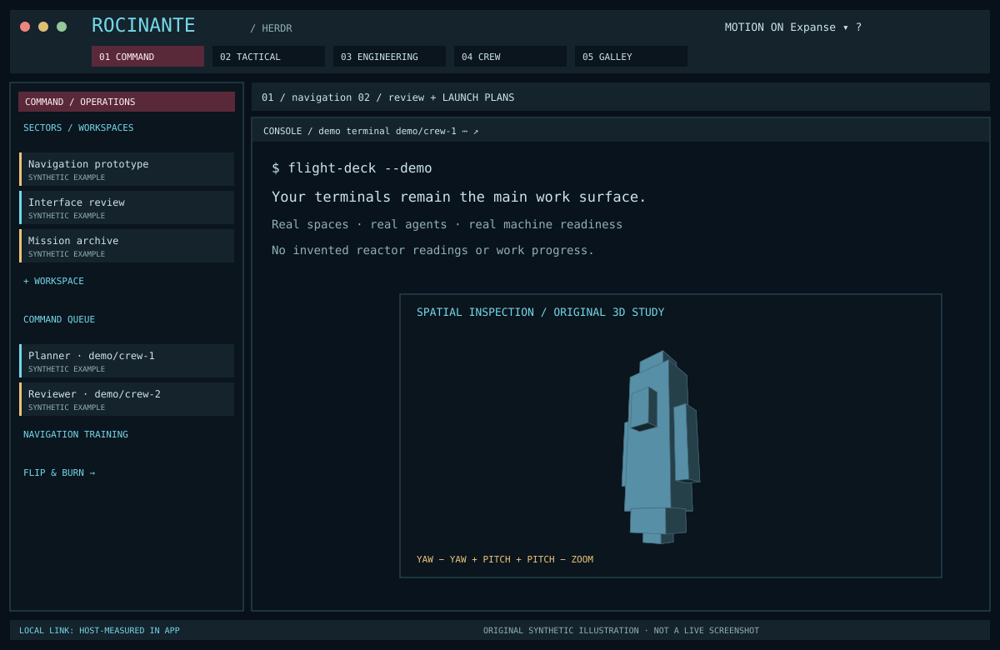

# Expanse Flight Deck

A practical independent-ship console around real Herdr terminals: cyan outlines, burgundy command strips, amber decisions and a compact operational manifest. Five station controls keep work central, with a galley archive and two games off watch.

## What you see

The root is a column: a 73px two-line flight-deck bar, resizable body row and 29px measured-host footer. The body has a 280px sidebar (220–440px) and a main column containing a 38px scrolling tab strip plus live terminals. Each pane has a 28px native header and explicit-target menu/zoom controls. Dark terminal background is #09131e in both appearances. Geist Mono is host-provided.

Dark chrome uses #0a151e wells, #14232c panels, #315663 boundaries, #75d7e7 accents, #5a2939 command strips and #edc476 decisions. Light chrome uses pale blue-gray wells with dark teal text. ROCI/UNN/BELT accent studies remain readable independently of terminal ANSI colors.

## How it behaves

Command lists real spaces and attention requests; Tactical groups every agent by working/blocked/done/idle; Engineering shows real machine readiness and tools; Crew lists actual titles and addresses; Galley offers games, archives and preferences. Working strips pulse through native opacity motion; blocked is amber, done green, idle muted. Nothing fabricates progress, enemies or ship health.

All lists scroll; long names truncate with tooltips. PLANS exposes the full workspace/tab list. SECTORS collapses the sidebar. Native menus target the clicked object and support arrows/Enter/Escape. + LAUNCH discovers installed agents on the selected workspace’s host. Optional pane rename is detected once per opened pane menu via its capability manifest.

Flip & Burn updates velocity before position, charges one unit for cardinal burns and none for coast, collision-checks the swept segment, supports exact undo and bounded route hints, and requires stationary arrival. Tight-Beam rotates a 4×4 relay chain, requires all 16 cells, has finite rotations and three transmit attempts, undo without transmission refunds, deterministic seeds and saved bests. Rules are in the pure model module and README.

The 48-face cutter transforms XYZ vertices with yaw/pitch, projects with perspective, lights face normals and depth-sorts native paths. Six local discoveries award patches; sound is muted by default. Reset requires confirmation and affects only Expanse progress.

## Built from

One `place:none` mod uses roles top, sidebar, tabs, pane, footer, menu, help, plans, archive, flight, relay and inspect. `main.js` selects roles; kit.js supplies consistent native controls. model.js, geometry.js and telemetry.js are pure. pane-rename.js capability-gates an optional dependency with no runtime import from that mod.

Live model APIs: spaces, agents, machines, panes, focused, layouts, settings and shared. Actions use explicit pane/tab/space/terminal IDs. Status data comes from Herdr, never polling. Local macOS telemetry uses scutil --nwi and pmset -g batt every 30s with overlap guard and failure states. No external requests. SVG vectors and an original 180ms synthesized MP3 live under assets.

## Watch out

Keep look keys on the root. Write place:none manifest before any entry point. Stage complete updates outside watched mods; rename whole folders; layout last. Native-check installed transitive imports before exposure, back up replaced targets and retain recovery files if rollback fails. Do not restart the core. Shared-window installation and QA require coordination and the lock described in the portable guide.

The native checker cannot prove geometry or later interactions. Light chrome must keep the dark terminal palette unless actual running agents have been verified otherwise. Local interface availability is not Internet reachability. Battery absence, unsupported platform and failed known hardware are different states. 3D is projected paths, not an engine. The games are not real ship controls.

## Done when

Pure rules pass complete wins, losses, invalid actions, exact resource and undo tests; all 999 relay seeds solve. Geometry is finite and depth sorted. Telemetry parser fixtures cover failure, missing hardware and power states. Isolated installation preserves unrelated state, refuses unsafe paths and collisions, validates imports, and recovers from injected failures.

Native checks pass every role, appearance, empty/populated room, menu target, optional rename state and game outcome. Coordinated live QA verifies the real switcher and context target, both games to victory, discoveries, 3D rotation, measured telemetry, real terminal readability and restoration of the prior window state. Report what was actually observed in docs/VALIDATION.md.

## Verified presentation lessons

Constrain prose to the dialog width. Horizontal scrolling on the entire body prevented wrapping in live GPUI; use it only around fixed geometry rows with explicit heights. Keep the prose body vertically scrollable. The hazard glyph uses the strip foreground so its burgundy tile remains readable in light mode. Dialog pixel caps and viewport fractions are complementary; compact-window interaction still needs separate live QA.
